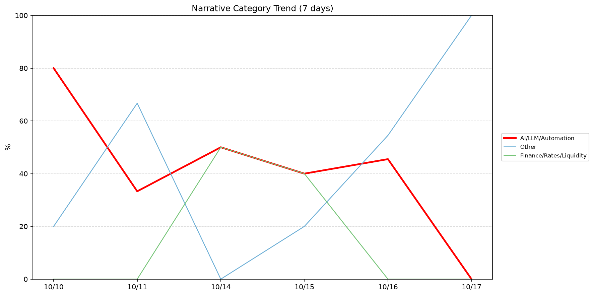
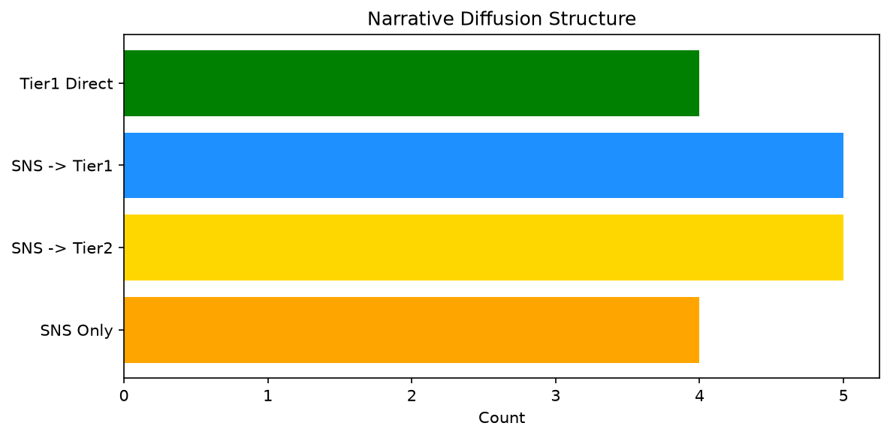

# 週次メタ分析レポート - 2026-10-17

> 分析期間: 過去7日間

---

## ショックタイプ分布

| ショックタイプ | 件数 |
|----------------|------|
| ナラティブシフト | 14 |
| 業績シグナル | 10 |
| テクノロジーショック | 8 |

---

## ナラティブ推移

### 2026-10-10
- AI/LLM/自動化: 80%
- その他: 20%

### 2026-10-11
- その他: 67%
- AI/LLM/自動化: 33%

### 2026-10-14
- AI/LLM/自動化: 50%
- 金融/金利/流動性: 50%

### 2026-10-15
- AI/LLM/自動化: 40%
- 金融/金利/流動性: 40%
- その他: 20%

### 2026-10-16
- その他: 55%
- AI/LLM/自動化: 46%

### 2026-10-17
- その他: 100%

---

## ナラティブ伝播構造

| 伝播パターン | 件数 |
|--------------|------|
| カバレッジなし | 14 |
| SNS→Tier1 | 5 |
| SNSのみ | 4 |
| SNS→Tier2 | 5 |
| Tier1直接 | 4 |

---

## 過熱警告事後検証

> ※ "過熱警告を出したか"と"AI偏重が実際に続いたか"の検証

| 指標 | 値 |
|------|-----|
| 検証対象数 | 8 |
| 正警告（TP） | 0 |
| 過剰警告（FP） | 0 |
| 正常判定（TN） | 5 |
| 見逃し（FN） | 3 |
| Recall | 0.0% |

- **2026-10-10**: 正常判定 — No overheat and conditions normal: ai_continued=False, price_sustained=False.
- **2026-10-11**: 見逃し — Missed overheat: AI events continued without price backing. An alert should have been raised.
- **2026-10-12**: 見逃し — Missed overheat: AI events continued without price backing. An alert should have been raised.
- **2026-10-13**: 見逃し — Missed overheat: AI events continued without price backing. An alert should have been raised.
- **2026-10-14**: 正常判定 — No overheat and conditions normal: ai_continued=False, price_sustained=True.
- **2026-10-15**: 正常判定 — No overheat and conditions normal: ai_continued=False, price_sustained=True.
- **2026-10-16**: 正常判定 — No overheat and conditions normal: ai_continued=False, price_sustained=False.
- **2026-10-17**: 正常判定 — No overheat and conditions normal: ai_continued=False, price_sustained=False.

---

## 非AIハイライト（週次）

### 1. JPM
- **サマリー**: 6件の言及（通常の7.1倍）
- **スコア**: 0.57
- **ナラティブ分類**: 金融/金利/流動性
- **ショックタイプ**: ナラティブシフト
- **AI関連度**: 11%

### 2. UNH
- **サマリー**: 出来高が平均の2.53倍
- **スコア**: 0.50
- **ナラティブ分類**: その他
- **ショックタイプ**: 業績シグナル
- **AI関連度**: 11%

### 3. JPM
- **サマリー**: 7件の言及（通常の8.2倍）
- **スコア**: 0.50
- **ナラティブ分類**: 金融/金利/流動性
- **ショックタイプ**: ナラティブシフト
- **AI関連度**: 11%

### 4. SNOW
- **サマリー**: 出来高が平均の2.04倍
- **スコア**: 0.46
- **ナラティブ分類**: その他
- **ショックタイプ**: ナラティブシフト
- **AI関連度**: 0%

### 5. JPM
- **サマリー**: 出来高が平均の1.8倍
- **スコア**: 0.43
- **ナラティブ分類**: 金融/金利/流動性
- **ショックタイプ**: ナラティブシフト
- **AI関連度**: 11%

---

## 構造持続確率 Top3

| 順位 | 銘柄 | SPP | ショックタイプ | 伝播パターン | サマリー |
|------|------|-----|----------------|--------------|----------|
| 1 | PLTR | 0.67 | 業績シグナル | なし | 前日比-3.69%の価格変動 |
| 2 | SNOW | 0.64 | 業績シグナル | なし | 前日比-6.34%の価格変動 |
| 3 | JPM | 0.62 | ナラティブシフト | Tier1直接 | 6件の言及（通常の7.1倍） |

---

## イベント持続性

| 銘柄 | 出現日数/観測日数 | SPP推移 | 最新SPP |
|------|------------------|---------|---------|
| NET | 4/6日 | 上昇 | 0.45 |
| GOOGL | 4/6日 | 横ばい | 0.42 |
| JPM | 3/6日 | 上昇 | 0.62 |
| UNH | 3/6日 | 下降 | 0.41 |
| DDOG | 3/6日 | 下降 | 0.32 |
| PLTR | 2/6日 | 横ばい | 0.67 |
| SNOW | 2/6日 | 上昇 | 0.64 |
| MSFT | 2/6日 | 上昇 | 0.59 |
| NVDA | 2/6日 | 下降 | 0.50 |
| LMT | 1/6日 | 横ばい | 0.59 |
| PATH | 1/6日 | 横ばい | 0.45 |

---

## 転換点候補

転換点候補は検出されませんでした。

---

## 組織インパクト仮説

### 1. 今週の構造変化は「ナラティブシフト」に集中（44%）。この領域の専門知識・人材の重要性が高まっている可能性。
- **根拠**: ショックタイプ分布: ナラティブシフトが14件

### 2. NET（AI/LLM/自動化）: 言及急増・出来高急増 + 業績シグナル + 4日間持続 + 引き締め環境 → 構造的な市場関心の変化の可能性、SPP上昇中
- **根拠**: 出現: 4/6日, SPP推移: 上昇
- **根拠要素**:
- 言及急増
- 出来高急増
- 価格変動
- 業績シグナル型
- テクノロジーショック型
- ナラティブシフト型
- 4日間持続観測
- SPP上昇（0.25→0.45）
- 引き締めレジーム下
- 関連: Cloudflare acquires Deno to improve its Workers programming model
- **データ期間**: 2026-10-10〜2026-10-17 (6日間)
- **信頼度注記**: 観測データに基づく示唆であり、因果関係を示すものではありません

### 3. GOOGL（AI/LLM/自動化）: 言及急増 + テクノロジーショック + 4日間持続 + 引き締め環境 → 構造的な市場関心の変化の可能性
- **根拠**: 出現: 4/6日, SPP推移: 横ばい
- **根拠要素**:
- 言及急増
- テクノロジーショック型
- ナラティブシフト型
- 4日間持続観測
- SPP横ばい（0.42）
- 引き締めレジーム下
- 関連: Google’s Universal Cart shopping tool launches in the US
- 関連: OpenAI, Google pushing new AI models easily tricked into making nudes, researchers say
- **データ期間**: 2026-10-10〜2026-10-17 (6日間)
- **信頼度注記**: 観測データに基づく示唆であり、因果関係を示すものではありません

### 4. JPM（金融/金利/流動性）: 言及急増・出来高急増 + ナラティブシフト + 3日間持続 + 引き締め環境 → 構造的な市場関心の変化の可能性、SPP上昇中
- **根拠**: 出現: 3/6日, SPP推移: 上昇
- **根拠要素**:
- 言及急増
- 出来高急増
- ナラティブシフト型
- 3日間持続観測
- SPP上昇（0.50→0.62）
- 引き締めレジーム下
- 関連: JPMorgan Chase blocks outside AI agents like Muse, Instinct from directly accessing accounts
- 関連: Bank earnings takeaways: Here's how JPMorgan, Goldman, Wells Fargo and Citi performed in Q3
- **データ期間**: 2026-10-10〜2026-10-17 (6日間)
- **信頼度注記**: 観測データに基づく示唆であり、因果関係を示すものではありません

---

## 市場レジーム推移

| 日付 | レジーム | ボラティリティ | 下落比率 | 信頼度 |
|------|----------|---------------|----------|--------|
| 2026-10-17 | 引き締め | 34.3% | 60% | 61% |
| 2026-10-16 | 高ボラ | 34.0% | 40% | 59% |
| 2026-10-15 | 高ボラ | 31.4% | 33% | 46% |
| 2026-10-14 | 高ボラ | 31.9% | 40% | 45% |
| 2026-10-13 | 高ボラ | 31.9% | 40% | 45% |
| 2026-10-12 | 高ボラ | 31.9% | 33% | 50% |
| 2026-10-11 | 高ボラ | 34.2% | 27% | 72% |
| 2026-10-10 | 高ボラ | 32.6% | 40% | 50% |

---

## 前週比較

> 比較期間: 2026-10-03〜2026-10-10 (6日分)

**イベント件数**: 今週 32 件 / 前週 23 件（差分 +9）

**支配的レジーム**: 高ボラ（変化なし）

### ショックタイプ増減

| ショックタイプ | 今週 | 前週 | 差分 |
|----------------|------|------|------|
| テクノロジーショック | 8 | 4 | +4 |
| ナラティブシフト | 14 | 13 | +1 |
| ビジネスモデルショック | 0 | 1 | -1 |
| 業績シグナル | 10 | 5 | +5 |

### ナラティブ比率変化

| カテゴリ | 今週平均 | 前週平均 | 差分(pt) |
|----------|----------|----------|----------|
| AI/LLM/自動化 | 41% | 45% | -4 |
| その他 | 44% | 38% | +5 |
| ガバナンス/経営 | 0% | 6% | -6 |
| 半導体/供給網 | 0% | 11% | -11 |
| 金融/金利/流動性 | 15% | 0% | +15 |

---

## レジーム・ナラティブ同時変動

> ※ 同時期の観測であり、因果関係を示すものではありません

- **2026-10-11**: レジーム異常（高ボラ）と「その他」ナラティブ集中（67%）が共起
- **2026-10-17**: レジーム変化（高ボラ→引き締め）と「AI/LLM/自動化」の46pt減少が同時期に観測
- **2026-10-17**: レジーム変化（高ボラ→引き締め）と「その他」の45pt増加が同時期に観測
- **2026-10-17**: レジーム異常（引き締め）と「その他」ナラティブ集中（100%）が共起

---

## 来週の監視比重提案

### 1. 「規制/政策/地政学」の監視比重を維持・注視
- **根拠**: 週平均ナラティブ比率0%と低く、イベント未検出だが、構造的に重要なカテゴリのため意図的な監視継続を推奨。
- **週平均ナラティブ比率**: 0%

### 2. 「エネルギー/資源」の監視比重を維持・注視
- **根拠**: 週平均ナラティブ比率0%と低く、イベント未検出だが、構造的に重要なカテゴリのため意図的な監視継続を推奨。
- **週平均ナラティブ比率**: 0%

### 3. 「その他」の過集中に注意
- **根拠**: 週平均ナラティブ比率44%と高く、他カテゴリの構造変化を見落とすリスクがあります。
- **週平均ナラティブ比率**: 44%
- **⚡ 急変フラグ**: 直近100%へ急変 — 動向注視を推奨

### 4. 「AI/LLM/自動化」の過集中に注意
- **根拠**: 週平均ナラティブ比率41%と高く、他カテゴリの構造変化を見落とすリスクがあります。
- **週平均ナラティブ比率**: 42%
- **⚡ 急変フラグ**: 直近0%へ急変 — 動向注視を推奨

---

*レポート生成日時: 2026-10-17 03:06:49*
