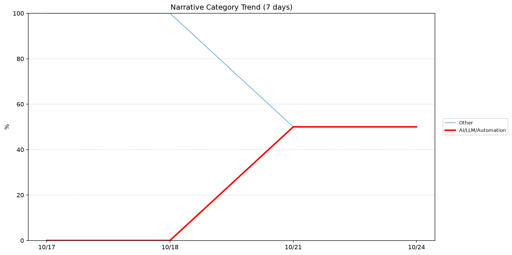
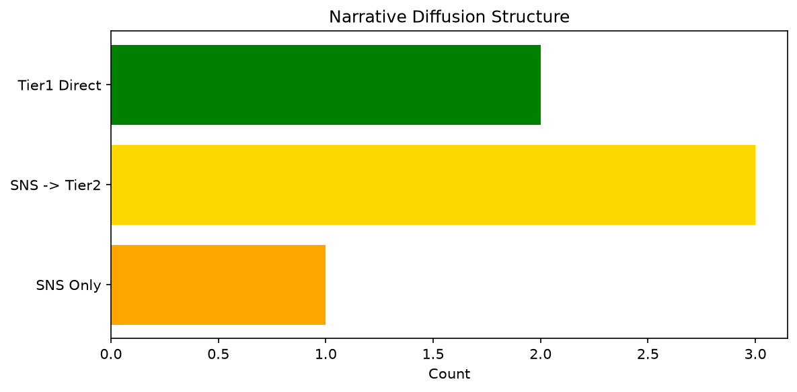

# 週次メタ分析レポート - 2026-10-24

> 分析期間: 過去7日間

---

## ショックタイプ分布

| ショックタイプ | 件数 |
|----------------|------|
| 業績シグナル | 13 |
| ナラティブシフト | 12 |

---

## ナラティブ推移

### 2026-10-17
- その他: 100%

### 2026-10-18
- その他: 100%

### 2026-10-21
- その他: 50%
- AI/LLM/自動化: 50%

### 2026-10-24
- その他: 50%
- AI/LLM/自動化: 50%

---

## ナラティブ伝播構造

| 伝播パターン | 件数 |
|--------------|------|
| SNS→Tier2 | 3 |
| Tier1直接 | 2 |
| カバレッジなし | 19 |
| SNSのみ | 1 |

---

## 過熱警告事後検証

> ※ "過熱警告を出したか"と"AI偏重が実際に続いたか"の検証

| 指標 | 値 |
|------|-----|
| 検証対象数 | 8 |
| 正警告（TP） | 0 |
| 過剰警告（FP） | 0 |
| 正常判定（TN） | 3 |
| 見逃し（FN） | 5 |
| Recall | 0.0% |

- **2026-10-17**: 正常判定 — No overheat and conditions normal: ai_continued=False, price_sustained=True.
- **2026-10-18**: 見逃し — Missed overheat: AI events continued without price backing. An alert should have been raised.
- **2026-10-19**: 見逃し — Missed overheat: AI events continued without price backing. An alert should have been raised.
- **2026-10-20**: 見逃し — Missed overheat: AI events continued without price backing. An alert should have been raised.
- **2026-10-21**: 正常判定 — No overheat and conditions normal: ai_continued=True, price_sustained=True.
- **2026-10-22**: 見逃し — Missed overheat: AI events continued without price backing. An alert should have been raised.
- **2026-10-23**: 見逃し — Missed overheat: AI events continued without price backing. An alert should have been raised.
- **2026-10-24**: 正常判定 — No overheat and conditions normal: ai_continued=False, price_sustained=False.

---

## 非AIハイライト（週次）

### 1. LMT
- **サマリー**: 出来高が平均の2.52倍
- **スコア**: 0.42
- **ナラティブ分類**: その他
- **ショックタイプ**: ナラティブシフト
- **AI関連度**: 0%

### 2. SNOW
- **サマリー**: 出来高が平均の2.04倍
- **スコア**: 0.38
- **ナラティブ分類**: その他
- **ショックタイプ**: ナラティブシフト
- **AI関連度**: 0%

### 3. SNOW
- **サマリー**: 前日比-8.43%の価格変動
- **スコア**: 0.31
- **ナラティブ分類**: その他
- **ショックタイプ**: 業績シグナル
- **AI関連度**: 0%

### 4. DDOG
- **サマリー**: 前日比-7.19%の価格変動
- **スコア**: 0.30
- **ナラティブ分類**: その他
- **ショックタイプ**: 業績シグナル
- **AI関連度**: 0%

### 5. CRWD
- **サマリー**: 出来高が平均の1.69倍
- **スコア**: 0.29
- **ナラティブ分類**: その他
- **ショックタイプ**: ナラティブシフト
- **AI関連度**: 0%

---

## 構造持続確率 Top3

| 順位 | 銘柄 | SPP | ショックタイプ | 伝播パターン | サマリー |
|------|------|-----|----------------|--------------|----------|
| 1 | NVDA | 0.85 | 業績シグナル | Tier1直接 | 前日比-4.4%の価格変動 |
| 2 | NEE | 0.66 | 業績シグナル | なし | 前日比+4.62%の価格変動 |
| 3 | DDOG | 0.62 | 業績シグナル | なし | 前日比-7.19%の価格変動 |

---

## イベント持続性

| 銘柄 | 出現日数/観測日数 | SPP推移 | 最新SPP |
|------|------------------|---------|---------|
| NET | 3/4日 | 横ばい | 0.43 |
| NVDA | 2/4日 | 上昇 | 0.85 |
| NEE | 2/4日 | 上昇 | 0.66 |
| PATH | 2/4日 | 上昇 | 0.54 |
| LMT | 2/4日 | 上昇 | 0.45 |
| GOOGL | 2/4日 | 下降 | 0.35 |
| DDOG | 1/4日 | 横ばい | 0.62 |
| PLTR | 1/4日 | 横ばい | 0.60 |
| JPM | 1/4日 | 横ばい | 0.53 |
| MSFT | 1/4日 | 横ばい | 0.44 |
| SNOW | 1/4日 | 横ばい | 0.42 |
| UNH | 1/4日 | 横ばい | 0.41 |
| CRWD | 1/4日 | 横ばい | 0.34 |

---

## 転換点候補

転換点候補は検出されませんでした。

---

## 組織インパクト仮説

### 1. 今週の構造変化は「業績シグナル」に集中（52%）。この領域の専門知識・人材の重要性が高まっている可能性。
- **根拠**: ショックタイプ分布: 業績シグナルが13件

### 2. NET（その他）: 出来高急増 + ナラティブシフト + 3日間持続 + 高ボラ環境 → 構造的な市場関心の変化の可能性
- **根拠**: 出現: 3/4日, SPP推移: 横ばい
- **根拠要素**:
- 出来高急増
- ナラティブシフト型
- 3日間持続観測
- SPP横ばい（0.43）
- 高ボラレジーム下
- **データ期間**: 2026-10-17〜2026-10-24 (4日間)
- **信頼度注記**: 観測データに基づく示唆であり、因果関係を示すものではありません

### 3. レジームが高ボラ→引き締めに変化 — リスク管理基準の見直しを検討する契機
- **根拠**: 前週: 高ボラ, 今週: 引き締め
- **根拠要素**:
- 前週レジーム: 高ボラ
- 今週レジーム: 引き締め
- **データ期間**: 2026-10-17〜2026-10-24 (4日間)
- **信頼度注記**: 観測データに基づく示唆であり、因果関係を示すものではありません

---

## 市場レジーム推移

| 日付 | レジーム | ボラティリティ | 下落比率 | 信頼度 |
|------|----------|---------------|----------|--------|
| 2026-10-24 | 高ボラ | 39.0% | 47% | 74% |
| 2026-10-23 | 高ボラ | 37.0% | 47% | 71% |
| 2026-10-22 | 引き締め | 36.4% | 53% | 60% |
| 2026-10-21 | 引き締め | 36.8% | 60% | 72% |
| 2026-10-20 | 引き締め | 36.8% | 53% | 62% |
| 2026-10-19 | 引き締め | 36.8% | 53% | 62% |
| 2026-10-18 | 引き締め | 38.0% | 60% | 76% |
| 2026-10-17 | 引き締め | 34.3% | 60% | 61% |

---

## 前週比較

> 比較期間: 2026-10-10〜2026-10-17 (6日分)

**イベント件数**: 今週 25 件 / 前週 32 件（差分 -7）

**支配的レジーム**: 高ボラ → 引き締め（変化あり）

### ショックタイプ増減

| ショックタイプ | 今週 | 前週 | 差分 |
|----------------|------|------|------|
| テクノロジーショック | 0 | 8 | -8 |
| ナラティブシフト | 12 | 14 | -2 |
| 業績シグナル | 13 | 10 | +3 |

### ナラティブ比率変化

| カテゴリ | 今週平均 | 前週平均 | 差分(pt) |
|----------|----------|----------|----------|
| AI/LLM/自動化 | 25% | 41% | -16 |
| その他 | 75% | 44% | +31 |
| 金融/金利/流動性 | 0% | 15% | -15 |

---

## レジーム・ナラティブ同時変動

> ※ 同時期の観測であり、因果関係を示すものではありません

- **2026-10-18**: レジーム異常（引き締め）と「その他」ナラティブ集中（100%）が共起

---

## 来週の監視比重提案

### 1. 「規制/政策/地政学」の監視比重を維持・注視
- **根拠**: 週平均ナラティブ比率0%と低く、イベント未検出だが、構造的に重要なカテゴリのため意図的な監視継続を推奨。
- **週平均ナラティブ比率**: 0%

### 2. 「金融/金利/流動性」の監視比重を維持・注視
- **根拠**: 週平均ナラティブ比率0%と低く、イベント未検出だが、構造的に重要なカテゴリのため意図的な監視継続を推奨。
- **週平均ナラティブ比率**: 0%

### 3. 「エネルギー/資源」の監視比重を維持・注視
- **根拠**: 週平均ナラティブ比率0%と低く、イベント未検出だが、構造的に重要なカテゴリのため意図的な監視継続を推奨。
- **週平均ナラティブ比率**: 0%

### 4. 「その他」の過集中に注意
- **根拠**: 週平均ナラティブ比率75%と高く、他カテゴリの構造変化を見落とすリスクがあります。
- **週平均ナラティブ比率**: 75%
- **⚡ 急変フラグ**: 直近50%へ急変 — 動向注視を推奨

---

*レポート生成日時: 2026-10-24 03:24:24*
