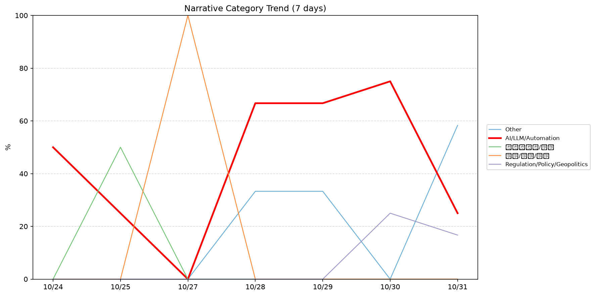
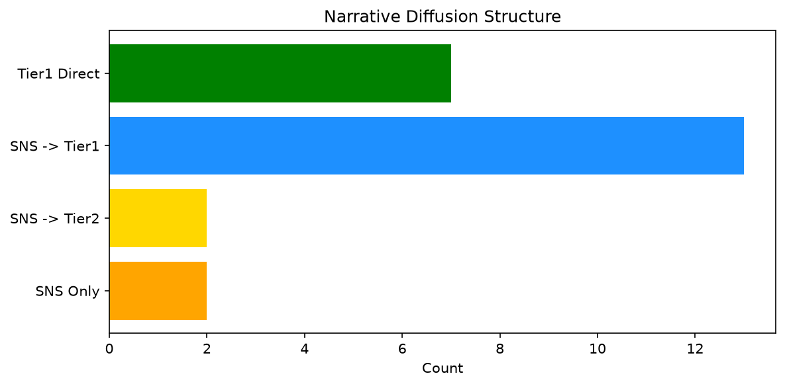

# 週次メタ分析レポート - 2026-10-31

> 分析期間: 過去7日間

---

## ショックタイプ分布

| ショックタイプ | 件数 |
|----------------|------|
| ナラティブシフト | 22 |
| 業績シグナル | 12 |
| テクノロジーショック | 1 |

---

## ナラティブ推移

### 2026-10-24
- その他: 50%
- AI/LLM/自動化: 50%

### 2026-10-25
- ガバナンス/経営: 50%
- その他: 25%
- AI/LLM/自動化: 25%

### 2026-10-27
- 社会/労働/教育: 100%

### 2026-10-28
- AI/LLM/自動化: 67%
- その他: 33%

### 2026-10-29
- AI/LLM/自動化: 67%
- その他: 33%

### 2026-10-30
- AI/LLM/自動化: 75%
- 規制/政策/地政学: 25%

### 2026-10-31
- その他: 58%
- AI/LLM/自動化: 25%
- 規制/政策/地政学: 17%

---

## ナラティブ伝播構造

| 伝播パターン | 件数 |
|--------------|------|
| SNS→Tier1 | 13 |
| Tier1直接 | 7 |
| カバレッジなし | 11 |
| SNSのみ | 2 |
| SNS→Tier2 | 2 |

---

## 過熱警告事後検証

> ※ "過熱警告を出したか"と"AI偏重が実際に続いたか"の検証

| 指標 | 値 |
|------|-----|
| 検証対象数 | 8 |
| 正警告（TP） | 0 |
| 過剰警告（FP） | 0 |
| 正常判定（TN） | 6 |
| 見逃し（FN） | 2 |
| Recall | 0.0% |

- **2026-10-24**: 正常判定 — No overheat and conditions normal: ai_continued=False, price_sustained=False.
- **2026-10-25**: 見逃し — Missed overheat: AI events continued without price backing. An alert should have been raised.
- **2026-10-26**: 見逃し — Missed overheat: AI events continued without price backing. An alert should have been raised.
- **2026-10-27**: 正常判定 — No overheat and conditions normal: ai_continued=True, price_sustained=True.
- **2026-10-28**: 正常判定 — No overheat and conditions normal: ai_continued=True, price_sustained=True.
- **2026-10-29**: 正常判定 — No overheat and conditions normal: ai_continued=False, price_sustained=True.
- **2026-10-30**: 正常判定 — No overheat and conditions normal: ai_continued=False, price_sustained=True.
- **2026-10-31**: 正常判定 — No overheat and conditions normal: ai_continued=False, price_sustained=False.

---

## 非AIハイライト（週次）

### 1. NVDA
- **サマリー**: 出来高が平均の1.75倍
- **スコア**: 0.65
- **ナラティブ分類**: 規制/政策/地政学
- **ショックタイプ**: ナラティブシフト
- **AI関連度**: 12%

### 2. NVDA
- **サマリー**: 9件の言及（通常の3.1倍）
- **スコア**: 0.62
- **ナラティブ分類**: 規制/政策/地政学
- **ショックタイプ**: ナラティブシフト
- **AI関連度**: 12%

### 3. NVDA
- **サマリー**: 8件の言及（通常の2.7倍）
- **スコア**: 0.57
- **ナラティブ分類**: 規制/政策/地政学
- **ショックタイプ**: ナラティブシフト
- **AI関連度**: 6%

### 4. XOM
- **サマリー**: 出来高が平均の1.91倍
- **スコア**: 0.57
- **ナラティブ分類**: その他
- **ショックタイプ**: ナラティブシフト
- **AI関連度**: 9%

### 5. DDOG
- **サマリー**: 出来高が平均の2.11倍
- **スコア**: 0.47
- **ナラティブ分類**: その他
- **ショックタイプ**: ナラティブシフト
- **AI関連度**: 0%

---

## 構造持続確率 Top3

| 順位 | 銘柄 | SPP | ショックタイプ | 伝播パターン | サマリー |
|------|------|-----|----------------|--------------|----------|
| 1 | NVDA | 0.73 | ナラティブシフト | SNS→Tier1 | 出来高が平均の1.75倍 |
| 2 | CRWD | 0.70 | ナラティブシフト | Tier1直接 | 出来高が平均の1.59倍 |
| 3 | XOM | 0.67 | ナラティブシフト | Tier1直接 | 出来高が平均の1.91倍 |

---

## イベント持続性

| 銘柄 | 出現日数/観測日数 | SPP推移 | 最新SPP |
|------|------------------|---------|---------|
| MSFT | 6/7日 | 上昇 | 0.66 |
| GOOGL | 5/7日 | 上昇 | 0.62 |
| NVDA | 4/7日 | 下降 | 0.73 |
| NET | 3/7日 | 横ばい | 0.43 |
| XOM | 2/7日 | 上昇 | 0.67 |
| NEE | 2/7日 | 下降 | 0.45 |
| LMT | 2/7日 | 横ばい | 0.45 |
| CRWD | 1/7日 | 横ばい | 0.70 |
| JPM | 1/7日 | 横ばい | 0.57 |
| DDOG | 1/7日 | 横ばい | 0.42 |
| SNOW | 1/7日 | 横ばい | 0.42 |

---

## 転換点候補

転換点候補は検出されませんでした。

---

## 組織インパクト仮説

### 1. 今週の構造変化は「ナラティブシフト」に集中（63%）。この領域の専門知識・人材の重要性が高まっている可能性。
- **根拠**: ショックタイプ分布: ナラティブシフトが22件

### 2. MSFT（AI/LLM/自動化）: 言及急増・出来高急増 + ナラティブシフト + 6日間持続 + 高ボラ環境 → 構造的な市場関心の変化の可能性、SPP上昇中
- **根拠**: 出現: 6/7日, SPP推移: 上昇
- **根拠要素**:
- 言及急増
- 出来高急増
- ナラティブシフト型
- 6日間持続観測
- SPP上昇（0.44→0.66）
- 高ボラレジーム下
- 関連: Microsoft is winning the cloud wars and becoming Wall Street’s new golden child
- 関連: Microsoft plans to raise $25 billion in debt as it pursues AI buildout
- **データ期間**: 2026-10-24〜2026-10-31 (7日間)
- **信頼度注記**: 観測データに基づく示唆であり、因果関係を示すものではありません

### 3. GOOGL（AI/LLM/自動化）: 価格変動・言及急増 + ナラティブシフト + 5日間持続 + 高ボラ環境 → 構造的な市場関心の変化の可能性、SPP上昇中
- **根拠**: 出現: 5/7日, SPP推移: 上昇
- **根拠要素**:
- 価格変動
- 言及急増
- 出来高急増
- ナラティブシフト型
- テクノロジーショック型
- 業績シグナル型
- 5日間持続観測
- SPP上昇（0.35→0.62）
- 高ボラレジーム下
- 関連: Google&#8217;s satellite AI server transmits its first response to Earth
- 関連: Google’s first data center satellite is online and writing poetry
- **データ期間**: 2026-10-24〜2026-10-31 (7日間)
- **信頼度注記**: 観測データに基づく示唆であり、因果関係を示すものではありません

### 4. NVDA（AI/LLM/自動化）: 価格変動・言及急増 + ナラティブシフト + 4日間持続 + 高ボラ環境 → 構造的な市場関心の変化の可能性、SPP下降中
- **根拠**: 出現: 4/7日, SPP推移: 下降
- **根拠要素**:
- 価格変動
- 言及急増
- 出来高急増
- ナラティブシフト型
- 業績シグナル型
- 4日間持続観測
- SPP下降（0.85→0.73）
- 高ボラレジーム下
- 関連: Nvidia weighs playing the cosigner for Nscale’s AI data center in West Virginia
- 関連: Nvidia responds to report Jensen Huang was target of Chinese asset, says diversion allegations were 'investigated and debunked'
- **データ期間**: 2026-10-24〜2026-10-31 (7日間)
- **信頼度注記**: 観測データに基づく示唆であり、因果関係を示すものではありません

---

## 市場レジーム推移

| 日付 | レジーム | ボラティリティ | 下落比率 | 信頼度 |
|------|----------|---------------|----------|--------|
| 2026-10-31 | 高ボラ | 42.6% | 47% | 74% |
| 2026-10-30 | 高ボラ | 38.0% | 20% | 100% |
| 2026-10-29 | 高ボラ | 38.2% | 20% | 100% |
| 2026-10-28 | 高ボラ | 37.9% | 27% | 98% |
| 2026-10-27 | 高ボラ | 38.0% | 40% | 82% |
| 2026-10-26 | 高ボラ | 38.0% | 40% | 82% |
| 2026-10-25 | 高ボラ | 39.9% | 40% | 82% |
| 2026-10-24 | 高ボラ | 39.0% | 47% | 74% |

---

## 前週比較

> 比較期間: 2026-10-17〜2026-10-24 (4日分)

**イベント件数**: 今週 35 件 / 前週 25 件（差分 +10）

**支配的レジーム**: 引き締め → 高ボラ（変化あり）

### ショックタイプ増減

| ショックタイプ | 今週 | 前週 | 差分 |
|----------------|------|------|------|
| テクノロジーショック | 1 | 0 | +1 |
| ナラティブシフト | 22 | 12 | +10 |
| 業績シグナル | 12 | 13 | -1 |

### ナラティブ比率変化

| カテゴリ | 今週平均 | 前週平均 | 差分(pt) |
|----------|----------|----------|----------|
| AI/LLM/自動化 | 44% | 25% | +19 |
| その他 | 29% | 75% | -46 |
| ガバナンス/経営 | 7% | 0% | +7 |
| 社会/労働/教育 | 14% | 0% | +14 |
| 規制/政策/地政学 | 6% | 0% | +6 |

---

## レジーム・ナラティブ同時変動

> ※ 同時期の観測であり、因果関係を示すものではありません

- **2026-10-27**: レジーム異常（高ボラ）と「社会/労働/教育」ナラティブ集中（100%）が共起
- **2026-10-28**: レジーム異常（高ボラ）と「AI/LLM/自動化」ナラティブ集中（67%）が共起
- **2026-10-29**: レジーム異常（高ボラ）と「AI/LLM/自動化」ナラティブ集中（67%）が共起
- **2026-10-30**: レジーム異常（高ボラ）と「AI/LLM/自動化」ナラティブ集中（75%）が共起

---

## 来週の監視比重提案

### 1. 「金融/金利/流動性」の監視比重を維持・注視
- **根拠**: 週平均ナラティブ比率0%と低く、イベント未検出だが、構造的に重要なカテゴリのため意図的な監視継続を推奨。
- **週平均ナラティブ比率**: 0%

### 2. 「エネルギー/資源」の監視比重を維持・注視
- **根拠**: 週平均ナラティブ比率0%と低く、イベント未検出だが、構造的に重要なカテゴリのため意図的な監視継続を推奨。
- **週平均ナラティブ比率**: 0%

### 3. 「規制/政策/地政学」の監視比重を引き上げ
- **根拠**: 週平均ナラティブ比率6%と低いが、過去7日で3件のイベントが検出されており、見落としリスクがあります。
- **週平均ナラティブ比率**: 6%

### 4. 「AI/LLM/自動化」の過集中に注意
- **根拠**: 週平均ナラティブ比率44%と高く、他カテゴリの構造変化を見落とすリスクがあります。
- **週平均ナラティブ比率**: 44%
- **⚡ 急変フラグ**: 直近25%へ急変 — 動向注視を推奨

### 5. 「その他」の過集中に注意
- **根拠**: 週平均ナラティブ比率29%と高く、他カテゴリの構造変化を見落とすリスクがあります。
- **週平均ナラティブ比率**: 29%
- **⚡ 急変フラグ**: 直近58%へ急変 — 動向注視を推奨

---

*レポート生成日時: 2026-10-31 04:12:27*
