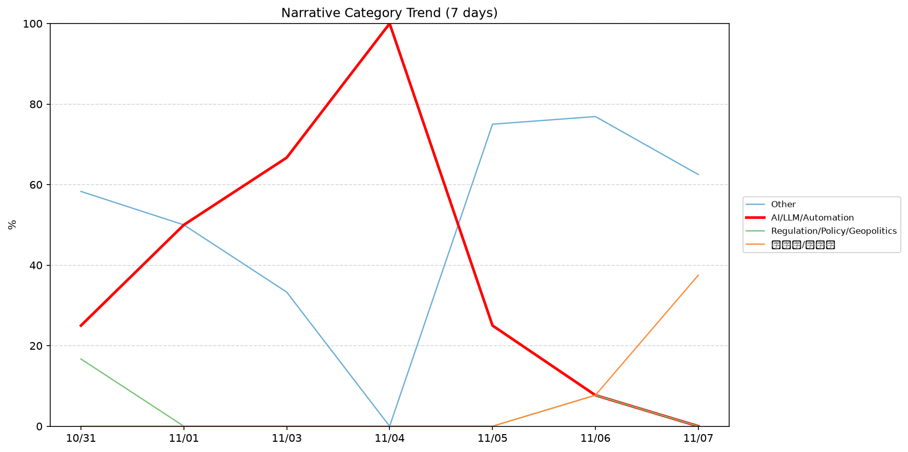
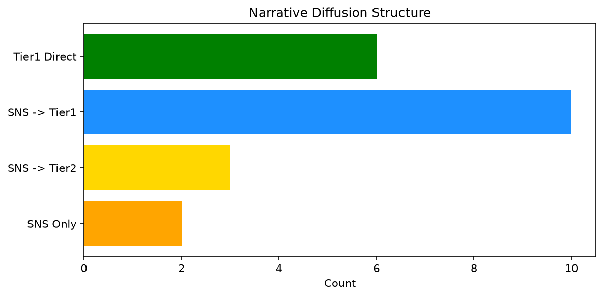

# 週次メタ分析レポート - 2026-11-07

> 分析期間: 過去7日間

---

## ショックタイプ分布

| ショックタイプ | 件数 |
|----------------|------|
| ナラティブシフト | 21 |
| 業績シグナル | 15 |
| テクノロジーショック | 5 |
| 規制ショック | 3 |
| ビジネスモデルショック | 1 |

---

## ナラティブ推移

### 2026-10-31
- その他: 58%
- AI/LLM/自動化: 25%
- 規制/政策/地政学: 17%

### 2026-11-01
- その他: 50%
- AI/LLM/自動化: 50%

### 2026-11-03
- AI/LLM/自動化: 67%
- その他: 33%

### 2026-11-04
- AI/LLM/自動化: 100%

### 2026-11-05
- その他: 75%
- AI/LLM/自動化: 25%

### 2026-11-06
- その他: 77%
- 規制/政策/地政学: 8%
- 半導体/供給網: 8%
- AI/LLM/自動化: 8%

### 2026-11-07
- その他: 62%
- 半導体/供給網: 38%

---

## ナラティブ伝播構造

| 伝播パターン | 件数 |
|--------------|------|
| SNS→Tier1 | 10 |
| カバレッジなし | 24 |
| SNS→Tier2 | 3 |
| Tier1直接 | 6 |
| SNSのみ | 2 |

---

## 過熱警告事後検証

> ※ "過熱警告を出したか"と"AI偏重が実際に続いたか"の検証

| 指標 | 値 |
|------|-----|
| 検証対象数 | 8 |
| 正警告（TP） | 0 |
| 過剰警告（FP） | 0 |
| 正常判定（TN） | 6 |
| 見逃し（FN） | 2 |
| Recall | 0.0% |

- **2026-10-31**: 正常判定 — No overheat and conditions normal: ai_continued=True, price_sustained=True.
- **2026-11-01**: 見逃し — Missed overheat: AI events continued without price backing. An alert should have been raised.
- **2026-11-02**: 見逃し — Missed overheat: AI events continued without price backing. An alert should have been raised.
- **2026-11-03**: 正常判定 — No overheat and conditions normal: ai_continued=False, price_sustained=True.
- **2026-11-04**: 正常判定 — No overheat and conditions normal: ai_continued=False, price_sustained=True.
- **2026-11-05**: 正常判定 — No overheat and conditions normal: ai_continued=False, price_sustained=True.
- **2026-11-06**: 正常判定 — No overheat and conditions normal: ai_continued=False, price_sustained=True.
- **2026-11-07**: 正常判定 — No overheat and conditions normal: ai_continued=False, price_sustained=False.

---

## 非AIハイライト（週次）

### 1. NET
- **サマリー**: 出来高が平均の2.47倍
- **スコア**: 0.65
- **ナラティブ分類**: 半導体/供給網
- **ショックタイプ**: テクノロジーショック
- **AI関連度**: 12%

### 2. NVDA
- **サマリー**: 出来高が平均の1.75倍
- **スコア**: 0.65
- **ナラティブ分類**: 規制/政策/地政学
- **ショックタイプ**: ナラティブシフト
- **AI関連度**: 12%

### 3. NVDA
- **サマリー**: 9件の言及（通常の3.1倍）
- **スコア**: 0.62
- **ナラティブ分類**: 規制/政策/地政学
- **ショックタイプ**: ナラティブシフト
- **AI関連度**: 12%

### 4. XOM
- **サマリー**: 出来高が平均の1.91倍
- **スコア**: 0.57
- **ナラティブ分類**: その他
- **ショックタイプ**: ナラティブシフト
- **AI関連度**: 9%

### 5. NET
- **サマリー**: 4件の言及（通常の8.9倍）
- **スコア**: 0.55
- **ナラティブ分類**: 半導体/供給網
- **ショックタイプ**: テクノロジーショック
- **AI関連度**: 12%

---

## 構造持続確率 Top3

| 順位 | 銘柄 | SPP | ショックタイプ | 伝播パターン | サマリー |
|------|------|-----|----------------|--------------|----------|
| 1 | JPM | 0.80 | 規制ショック | Tier1直接 | 前日比+4.18%の価格変動 |
| 2 | NET | 0.70 | テクノロジーショック | SNS→Tier1 | 出来高が平均の2.47倍 |
| 3 | GOOGL | 0.53 | 規制ショック | SNS→Tier2 | 20件の言及（通常の2.6倍） |

---

## イベント持続性

| 銘柄 | 出現日数/観測日数 | SPP推移 | 最新SPP |
|------|------------------|---------|---------|
| GOOGL | 5/7日 | 下降 | 0.53 |
| NET | 4/7日 | 上昇 | 0.70 |
| PLTR | 4/7日 | 横ばい | 0.46 |
| DDOG | 4/7日 | 横ばい | 0.45 |
| MSFT | 3/7日 | 下降 | 0.46 |
| XOM | 3/7日 | 下降 | 0.42 |
| JPM | 2/7日 | 上昇 | 0.80 |
| NVDA | 2/7日 | 下降 | 0.50 |
| NEE | 2/7日 | 横ばい | 0.42 |
| CRWD | 2/7日 | 下降 | 0.38 |
| SNOW | 1/7日 | 横ばい | 0.42 |
| LMT | 1/7日 | 横ばい | 0.34 |

---

## 転換点候補

- 「半導体/供給網」が2026-11-06→2026-11-07で30ポイント上昇（8% → 38%）
- 「AI/LLM/自動化」が2026-11-04→2026-11-05で75ポイント下降（100% → 25%）
- 「その他」が2026-11-04→2026-11-05で75ポイント上昇（0% → 75%）

---

## 組織インパクト仮説

### 1. 今週の構造変化は「ナラティブシフト」に集中（47%）。この領域の専門知識・人材の重要性が高まっている可能性。
- **根拠**: ショックタイプ分布: ナラティブシフトが21件

### 2. 「半導体/供給網」ナラティブの急上昇は、この分野への注目シフトを示唆。関連するリスク管理体制の見直しが必要かもしれません。
- **根拠**: 「半導体/供給網」が2026-11-06→2026-11-07で30ポイント上昇（8% → 38%）

### 3. 「AI/LLM/自動化」ナラティブの下降は、市場の関心が他分野に移行中であることを示唆。この分野の見落としリスクに注意が必要です。
- **根拠**: 「AI/LLM/自動化」が2026-11-04→2026-11-05で75ポイント下降（100% → 25%）

### 4. 「その他」ナラティブの急上昇は、この分野への注目シフトを示唆。関連するリスク管理体制の見直しが必要かもしれません。
- **根拠**: 「その他」が2026-11-04→2026-11-05で75ポイント上昇（0% → 75%）

### 5. GOOGL（AI/LLM/自動化）: 言及急増 + ビジネスモデルショック + 5日間持続 + 引き締め環境 → 構造的な市場関心の変化の可能性、SPP下降中
- **根拠**: 出現: 5/7日, SPP推移: 下降
- **根拠要素**:
- 言及急増
- ビジネスモデルショック型
- 規制ショック型
- 業績シグナル型
- ナラティブシフト型
- 5日間持続観測
- SPP下降（0.62→0.53）
- 引き締めレジーム下
- 関連: Meta, Google, and TikTok sue California AG over teen social media law
- 関連: Google: Schools can keep search while skipping Gemini, but AI search is non-negotiable
- **データ期間**: 2026-10-31〜2026-11-07 (7日間)
- **信頼度注記**: 観測データに基づく示唆であり、因果関係を示すものではありません

### 6. NET（その他）: 出来高急増・言及急増 + テクノロジーショック + 4日間持続 + 引き締め環境 → 構造的な市場関心の変化の可能性、SPP上昇中
- **根拠**: 出現: 4/7日, SPP推移: 上昇
- **根拠要素**:
- 出来高急増
- 言及急増
- テクノロジーショック型
- ナラティブシフト型
- 4日間持続観測
- SPP上昇（0.43→0.70）
- 引き締めレジーム下
- 関連: Cloudflare’s stock mounts a big comeback after fastest sales surge in nearly 4 years
- **データ期間**: 2026-10-31〜2026-11-07 (7日間)
- **信頼度注記**: 観測データに基づく示唆であり、因果関係を示すものではありません

### 7. PLTR（AI/LLM/自動化）: 出来高急増・価格変動 + 業績シグナル + 4日間持続 + 引き締め環境 → 構造的な市場関心の変化の可能性
- **根拠**: 出現: 4/7日, SPP推移: 横ばい
- **根拠要素**:
- 出来高急増
- 価格変動
- 言及急増
- 業績シグナル型
- ナラティブシフト型
- 4日間持続観測
- SPP横ばい（0.46）
- 引き締めレジーム下
- 関連: Hiding inside Palantir’s skyrocketing quarter is a foreboding signal
- 関連: Here’s why Palantir’s stock is down despite a ‘bombastic’ quarter
- **データ期間**: 2026-10-31〜2026-11-07 (7日間)
- **信頼度注記**: 観測データに基づく示唆であり、因果関係を示すものではありません

---

## 市場レジーム推移

| 日付 | レジーム | ボラティリティ | 下落比率 | 信頼度 |
|------|----------|---------------|----------|--------|
| 2026-11-07 | 引き締め | 52.3% | 67% | 87% |
| 2026-11-06 | 引き締め | 48.7% | 53% | 65% |
| 2026-11-05 | 引き締め | 45.3% | 60% | 76% |
| 2026-11-04 | 引き締め | 44.8% | 60% | 76% |
| 2026-11-03 | 引き締め | 44.8% | 60% | 76% |
| 2026-11-02 | 引き締め | 44.2% | 60% | 76% |
| 2026-11-01 | 引き締め | 43.5% | 53% | 65% |
| 2026-10-31 | 高ボラ | 42.6% | 47% | 74% |

---

## 前週比較

> 比較期間: 2026-10-24〜2026-10-31 (7日分)

**イベント件数**: 今週 45 件 / 前週 35 件（差分 +10）

**支配的レジーム**: 高ボラ → 引き締め（変化あり）

### ショックタイプ増減

| ショックタイプ | 今週 | 前週 | 差分 |
|----------------|------|------|------|
| テクノロジーショック | 5 | 1 | +4 |
| ナラティブシフト | 21 | 22 | -1 |
| ビジネスモデルショック | 1 | 0 | +1 |
| 業績シグナル | 15 | 12 | +3 |
| 規制ショック | 3 | 0 | +3 |

### ナラティブ比率変化

| カテゴリ | 今週平均 | 前週平均 | 差分(pt) |
|----------|----------|----------|----------|
| AI/LLM/自動化 | 39% | 44% | -5 |
| その他 | 51% | 29% | +22 |
| ガバナンス/経営 | 0% | 7% | -7 |
| 半導体/供給網 | 6% | 0% | +6 |
| 社会/労働/教育 | 0% | 14% | -14 |
| 規制/政策/地政学 | 3% | 6% | -2 |

---

## レジーム・ナラティブ同時変動

> ※ 同時期の観測であり、因果関係を示すものではありません

- **2026-11-01**: レジーム変化（高ボラ→引き締め）と「AI/LLM/自動化」の25pt増加が同時期に観測
- **2026-11-01**: レジーム変化（高ボラ→引き締め）と「規制/政策/地政学」の17pt減少が同時期に観測
- **2026-11-03**: レジーム異常（引き締め）と「AI/LLM/自動化」ナラティブ集中（67%）が共起
- **2026-11-04**: レジーム異常（引き締め）と「AI/LLM/自動化」ナラティブ集中（100%）が共起
- **2026-11-05**: レジーム異常（引き締め）と「その他」ナラティブ集中（75%）が共起
- **2026-11-06**: レジーム異常（引き締め）と「その他」ナラティブ集中（77%）が共起
- **2026-11-07**: レジーム異常（引き締め）と「その他」ナラティブ集中（62%）が共起

---

## 来週の監視比重提案

### 1. 「金融/金利/流動性」の監視比重を維持・注視
- **根拠**: 週平均ナラティブ比率0%と低く、イベント未検出だが、構造的に重要なカテゴリのため意図的な監視継続を推奨。
- **週平均ナラティブ比率**: 0%

### 2. 「エネルギー/資源」の監視比重を維持・注視
- **根拠**: 週平均ナラティブ比率0%と低く、イベント未検出だが、構造的に重要なカテゴリのため意図的な監視継続を推奨。
- **週平均ナラティブ比率**: 0%

### 3. 「規制/政策/地政学」の監視比重を引き上げ
- **根拠**: 週平均ナラティブ比率3%と低いが、過去7日で3件のイベントが検出されており、見落としリスクがあります。
- **週平均ナラティブ比率**: 4%

### 4. 「その他」の過集中に注意
- **根拠**: 週平均ナラティブ比率51%と高く、他カテゴリの構造変化を見落とすリスクがあります。
- **週平均ナラティブ比率**: 51%

### 5. 「AI/LLM/自動化」の過集中に注意
- **根拠**: 週平均ナラティブ比率39%と高く、他カテゴリの構造変化を見落とすリスクがあります。
- **週平均ナラティブ比率**: 39%
- **⚡ 急変フラグ**: 直近0%へ急変 — 動向注視を推奨

---

*レポート生成日時: 2026-11-07 04:46:03*
