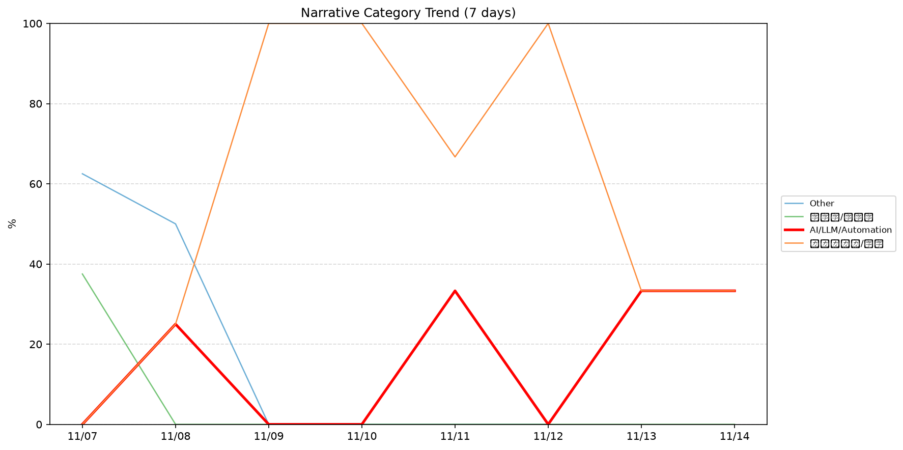
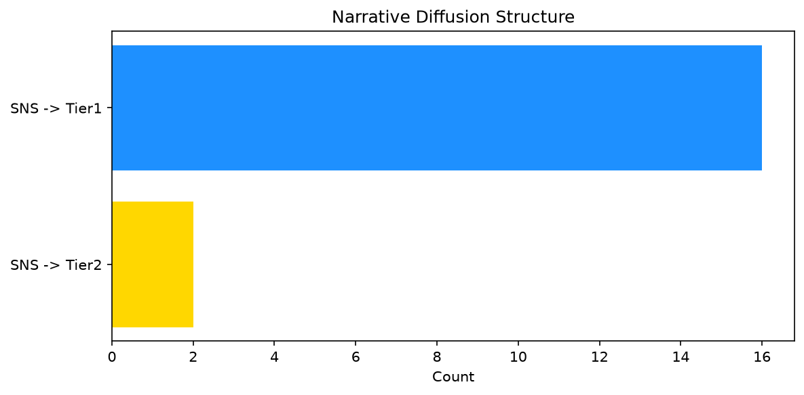

# 週次メタ分析レポート - 2026-11-14

> 分析期間: 過去7日間

---

## ショックタイプ分布

| ショックタイプ | 件数 |
|----------------|------|
| ナラティブシフト | 9 |
| テクノロジーショック | 7 |
| 業績シグナル | 5 |
| 規制ショック | 4 |

---

## ナラティブ推移

### 2026-11-07
- その他: 62%
- 半導体/供給網: 38%

### 2026-11-08
- その他: 50%
- AI/LLM/自動化: 25%
- ガバナンス/経営: 25%

### 2026-11-09
- ガバナンス/経営: 100%

### 2026-11-10
- ガバナンス/経営: 100%

### 2026-11-11
- ガバナンス/経営: 67%
- AI/LLM/自動化: 33%

### 2026-11-12
- ガバナンス/経営: 100%

### 2026-11-13
- AI/LLM/自動化: 33%
- その他: 33%
- ガバナンス/経営: 33%

### 2026-11-14
- AI/LLM/自動化: 33%
- その他: 33%
- ガバナンス/経営: 33%

---

## ナラティブ伝播構造

| 伝播パターン | 件数 |
|--------------|------|
| SNS→Tier1 | 16 |
| SNS→Tier2 | 2 |
| カバレッジなし | 7 |

---

## 過熱警告事後検証

> ※ "過熱警告を出したか"と"AI偏重が実際に続いたか"の検証

| 指標 | 値 |
|------|-----|
| 検証対象数 | 8 |
| 正警告（TP） | 0 |
| 過剰警告（FP） | 0 |
| 正常判定（TN） | 8 |
| 見逃し（FN） | 0 |

- **2026-11-07**: 正常判定 — No overheat and conditions normal: ai_continued=False, price_sustained=True.
- **2026-11-08**: 正常判定 — No overheat and conditions normal: ai_continued=False, price_sustained=True.
- **2026-11-09**: 正常判定 — No overheat and conditions normal: ai_continued=False, price_sustained=True.
- **2026-11-10**: 正常判定 — No overheat and conditions normal: ai_continued=False, price_sustained=True.
- **2026-11-11**: 正常判定 — No overheat and conditions normal: ai_continued=False, price_sustained=False.
- **2026-11-12**: 正常判定 — No overheat and conditions normal: ai_continued=False, price_sustained=False.
- **2026-11-13**: 正常判定 — No overheat and conditions normal: ai_continued=False, price_sustained=False.
- **2026-11-14**: 正常判定 — No overheat and conditions normal: ai_continued=False, price_sustained=False.

---

## 非AIハイライト（週次）

### 1. NVDA
- **サマリー**: 13件の言及（通常の4.0倍）
- **スコア**: 0.78
- **ナラティブ分類**: ガバナンス/経営
- **ショックタイプ**: ナラティブシフト
- **AI関連度**: 8%

### 2. MSFT
- **サマリー**: 30件の言及（通常の6.5倍）
- **スコア**: 0.72
- **ナラティブ分類**: その他
- **ショックタイプ**: 業績シグナル
- **AI関連度**: 3%

### 3. NVDA
- **サマリー**: 85件の言及（通常の8.0倍）
- **スコア**: 0.72
- **ナラティブ分類**: ガバナンス/経営
- **ショックタイプ**: テクノロジーショック
- **AI関連度**: 10%

### 4. MSFT
- **サマリー**: 19件の言及（通常の4.7倍）
- **スコア**: 0.72
- **ナラティブ分類**: その他
- **ショックタイプ**: 業績シグナル
- **AI関連度**: 3%

### 5. NVDA
- **サマリー**: 75件の言及（通常の8.2倍）
- **スコア**: 0.72
- **ナラティブ分類**: ガバナンス/経営
- **ショックタイプ**: テクノロジーショック
- **AI関連度**: 8%

---

## 構造持続確率 Top3

| 順位 | 銘柄 | SPP | ショックタイプ | 伝播パターン | サマリー |
|------|------|-----|----------------|--------------|----------|
| 1 | NVDA | 0.66 | テクノロジーショック | SNS→Tier1 | 85件の言及（通常の8.0倍） |
| 2 | MSFT | 0.60 | 業績シグナル | SNS→Tier1 | 30件の言及（通常の6.5倍） |
| 3 | GOOGL | 0.51 | テクノロジーショック | SNS→Tier1 | 18件の言及（通常の2.3倍） |

---

## イベント持続性

| 銘柄 | 出現日数/観測日数 | SPP推移 | 最新SPP |
|------|------------------|---------|---------|
| NVDA | 8/8日 | 上昇 | 0.66 |
| MSFT | 3/8日 | 上昇 | 0.60 |
| GOOGL | 3/8日 | 下降 | 0.51 |
| NET | 2/8日 | 下降 | 0.41 |
| PLTR | 1/8日 | 横ばい | 0.46 |
| DDOG | 1/8日 | 横ばい | 0.45 |
| CRWD | 1/8日 | 横ばい | 0.38 |

---

## 転換点候補

- 「ガバナンス/経営」が2026-11-08→2026-11-09で75ポイント上昇（25% → 100%）
- 「その他」が2026-11-08→2026-11-09で50ポイント下降（50% → 0%）

---

## 組織インパクト仮説

### 1. 「ガバナンス/経営」ナラティブの急上昇は、この分野への注目シフトを示唆。関連するリスク管理体制の見直しが必要かもしれません。
- **根拠**: 「ガバナンス/経営」が2026-11-08→2026-11-09で75ポイント上昇（25% → 100%）

### 2. 「その他」ナラティブの下降は、市場の関心が他分野に移行中であることを示唆。この分野の見落としリスクに注意が必要です。
- **根拠**: 「その他」が2026-11-08→2026-11-09で50ポイント下降（50% → 0%）

### 3. NVDA（ガバナンス/経営）: 言及急増・出来高急増 + 規制ショック + 8日間持続 + 引き締め環境 → 構造的な市場関心の変化の可能性、SPP上昇中
- **根拠**: 出現: 8/8日, SPP推移: 上昇
- **根拠要素**:
- 言及急増
- 出来高急増
- 規制ショック型
- ナラティブシフト型
- テクノロジーショック型
- 8日間持続観測
- SPP上昇（0.50→0.66）
- 引き締めレジーム下
- 関連: Trump doesn’t plan to raise Nvidia, spy issue during China trip: U.S. officials
- 関連: Nvidia is done with Jensen Huang. The fallout in Washington is just beginning
- **データ期間**: 2026-11-07〜2026-11-14 (8日間)
- **信頼度注記**: 観測データに基づく示唆であり、因果関係を示すものではありません

### 4. MSFT（AI/LLM/自動化）: 言及急増 + ナラティブシフト + 3日間持続 + 引き締め環境 → 構造的な市場関心の変化の可能性、SPP上昇中
- **根拠**: 出現: 3/8日, SPP推移: 上昇
- **根拠要素**:
- 言及急増
- ナラティブシフト型
- 業績シグナル型
- 3日間持続観測
- SPP上昇（0.45→0.60）
- 引き締めレジーム下
- 関連: Microsoft&#8217;s massive Outlook outage might be over
- 関連: Microsoft’s global outage may be worse than Amazon's or CrowdStrike's, expert says
- **データ期間**: 2026-11-07〜2026-11-14 (8日間)
- **信頼度注記**: 観測データに基づく示唆であり、因果関係を示すものではありません

### 5. GOOGL（AI/LLM/自動化）: 言及急増 + ナラティブシフト + 3日間持続 + 引き締め環境 → 構造的な市場関心の変化の可能性、SPP下降中
- **根拠**: 出現: 3/8日, SPP推移: 下降
- **根拠要素**:
- 言及急増
- ナラティブシフト型
- テクノロジーショック型
- 3日間持続観測
- SPP下降（0.64→0.51）
- 引き締めレジーム下
- 関連: Apple, Alphabet and Uber survived major founder transitions. Nvidia will be a harder test
- 関連: Google’s new Gemini model is better at understanding complicated questions
- **データ期間**: 2026-11-07〜2026-11-14 (8日間)
- **信頼度注記**: 観測データに基づく示唆であり、因果関係を示すものではありません

---

## 市場レジーム推移

| 日付 | レジーム | ボラティリティ | 下落比率 | 信頼度 |
|------|----------|---------------|----------|--------|
| 2026-11-14 | 引き締め | 52.8% | 67% | 87% |
| 2026-11-13 | 引き締め | 53.6% | 67% | 87% |
| 2026-11-12 | 引き締め | 53.5% | 73% | 97% |
| 2026-11-11 | 引き締め | 53.5% | 73% | 97% |
| 2026-11-10 | 引き締め | 53.8% | 67% | 87% |
| 2026-11-09 | 引き締め | 53.1% | 73% | 97% |
| 2026-11-08 | 引き締め | 52.0% | 73% | 97% |
| 2026-11-07 | 引き締め | 52.3% | 67% | 87% |

---

## 前週比較

> 比較期間: 2026-10-31〜2026-11-07 (7日分)

**イベント件数**: 今週 25 件 / 前週 45 件（差分 -20）

**支配的レジーム**: 引き締め（変化なし）

### ショックタイプ増減

| ショックタイプ | 今週 | 前週 | 差分 |
|----------------|------|------|------|
| テクノロジーショック | 7 | 5 | +2 |
| ナラティブシフト | 9 | 21 | -12 |
| ビジネスモデルショック | 0 | 1 | -1 |
| 業績シグナル | 5 | 15 | -10 |
| 規制ショック | 4 | 3 | +1 |

### ナラティブ比率変化

| カテゴリ | 今週平均 | 前週平均 | 差分(pt) |
|----------|----------|----------|----------|
| AI/LLM/自動化 | 16% | 39% | -24 |
| その他 | 22% | 51% | -28 |
| ガバナンス/経営 | 57% | 0% | +57 |
| 半導体/供給網 | 5% | 6% | -2 |
| 規制/政策/地政学 | 0% | 3% | -3 |

---

## レジーム・ナラティブ同時変動

> ※ 同時期の観測であり、因果関係を示すものではありません

- **2026-11-09**: レジーム異常（引き締め）と「ガバナンス/経営」ナラティブ集中（100%）が共起
- **2026-11-10**: レジーム異常（引き締め）と「ガバナンス/経営」ナラティブ集中（100%）が共起
- **2026-11-11**: レジーム異常（引き締め）と「ガバナンス/経営」ナラティブ集中（67%）が共起
- **2026-11-12**: レジーム異常（引き締め）と「ガバナンス/経営」ナラティブ集中（100%）が共起

---

## 来週の監視比重提案

### 1. 「規制/政策/地政学」の監視比重を維持・注視
- **根拠**: 週平均ナラティブ比率0%と低く、イベント未検出だが、構造的に重要なカテゴリのため意図的な監視継続を推奨。
- **週平均ナラティブ比率**: 0%

### 2. 「金融/金利/流動性」の監視比重を維持・注視
- **根拠**: 週平均ナラティブ比率0%と低く、イベント未検出だが、構造的に重要なカテゴリのため意図的な監視継続を推奨。
- **週平均ナラティブ比率**: 0%

### 3. 「エネルギー/資源」の監視比重を維持・注視
- **根拠**: 週平均ナラティブ比率0%と低く、イベント未検出だが、構造的に重要なカテゴリのため意図的な監視継続を推奨。
- **週平均ナラティブ比率**: 0%

### 4. 「半導体/供給網」の監視比重を引き上げ
- **根拠**: 週平均ナラティブ比率5%と低いが、過去7日で3件のイベントが検出されており、見落としリスクがあります。
- **週平均ナラティブ比率**: 5%

### 5. 「ガバナンス/経営」の過集中に注意
- **根拠**: 週平均ナラティブ比率57%と高く、他カテゴリの構造変化を見落とすリスクがあります。
- **週平均ナラティブ比率**: 57%
- **⚡ 急変フラグ**: 直近33%へ急変 — 動向注視を推奨

---

*レポート生成日時: 2026-11-14 05:01:55*
