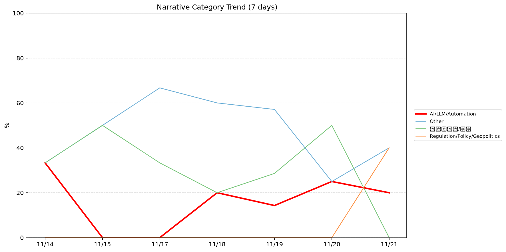
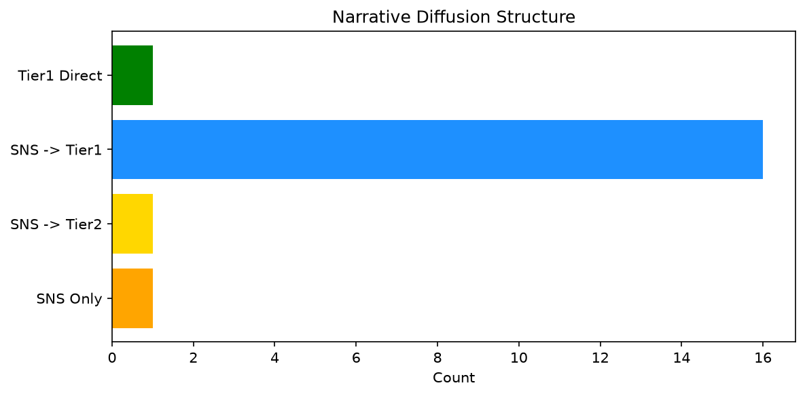

# 週次メタ分析レポート - 2026-11-21

> 分析期間: 過去7日間

---

## ショックタイプ分布

| ショックタイプ | 件数 |
|----------------|------|
| ナラティブシフト | 11 |
| 業績シグナル | 9 |
| テクノロジーショック | 6 |
| 規制ショック | 3 |

---

## ナラティブ推移

### 2026-11-14
- AI/LLM/自動化: 33%
- その他: 33%
- ガバナンス/経営: 33%

### 2026-11-15
- その他: 50%
- ガバナンス/経営: 50%

### 2026-11-17
- その他: 67%
- ガバナンス/経営: 33%

### 2026-11-18
- その他: 60%
- AI/LLM/自動化: 20%
- ガバナンス/経営: 20%

### 2026-11-19
- その他: 57%
- ガバナンス/経営: 29%
- AI/LLM/自動化: 14%

### 2026-11-20
- ガバナンス/経営: 50%
- その他: 25%
- AI/LLM/自動化: 25%

### 2026-11-21
- その他: 40%
- 規制/政策/地政学: 40%
- AI/LLM/自動化: 20%

---

## ナラティブ伝播構造

| 伝播パターン | 件数 |
|--------------|------|
| SNS→Tier1 | 16 |
| SNSのみ | 1 |
| カバレッジなし | 10 |
| Tier1直接 | 1 |
| SNS→Tier2 | 1 |

---

## 過熱警告事後検証

> ※ "過熱警告を出したか"と"AI偏重が実際に続いたか"の検証

| 指標 | 値 |
|------|-----|
| 検証対象数 | 8 |
| 正警告（TP） | 0 |
| 過剰警告（FP） | 0 |
| 正常判定（TN） | 8 |
| 見逃し（FN） | 0 |

- **2026-11-14**: 正常判定 — No overheat and conditions normal: ai_continued=False, price_sustained=False.
- **2026-11-15**: 正常判定 — No overheat and conditions normal: ai_continued=False, price_sustained=False.
- **2026-11-16**: 正常判定 — No overheat and conditions normal: ai_continued=False, price_sustained=False.
- **2026-11-17**: 正常判定 — No overheat and conditions normal: ai_continued=False, price_sustained=True.
- **2026-11-18**: 正常判定 — No overheat and conditions normal: ai_continued=False, price_sustained=True.
- **2026-11-19**: 正常判定 — No overheat and conditions normal: ai_continued=False, price_sustained=True.
- **2026-11-20**: 正常判定 — No overheat and conditions normal: ai_continued=False, price_sustained=True.
- **2026-11-21**: 正常判定 — No overheat and conditions normal: ai_continued=False, price_sustained=False.

---

## 非AIハイライト（週次）

### 1. NVDA
- **サマリー**: 63件の言及（通常の4.1倍）
- **スコア**: 0.92
- **ナラティブ分類**: ガバナンス/経営
- **ショックタイプ**: 業績シグナル
- **AI関連度**: 5%

### 2. NVDA
- **サマリー**: 66件の言及（通常の4.5倍）
- **スコア**: 0.78
- **ナラティブ分類**: ガバナンス/経営
- **ショックタイプ**: 業績シグナル
- **AI関連度**: 5%

### 3. NVDA
- **サマリー**: 33件の言及（通常の2.1倍）
- **スコア**: 0.78
- **ナラティブ分類**: ガバナンス/経営
- **ショックタイプ**: 規制ショック
- **AI関連度**: 5%

### 4. MSFT
- **サマリー**: 30件の言及（通常の6.5倍）
- **スコア**: 0.72
- **ナラティブ分類**: その他
- **ショックタイプ**: 業績シグナル
- **AI関連度**: 3%

### 5. NVDA
- **サマリー**: 85件の言及（通常の8.0倍）
- **スコア**: 0.72
- **ナラティブ分類**: ガバナンス/経営
- **ショックタイプ**: テクノロジーショック
- **AI関連度**: 10%

---

## 構造持続確率 Top3

| 順位 | 銘柄 | SPP | ショックタイプ | 伝播パターン | サマリー |
|------|------|-----|----------------|--------------|----------|
| 1 | NVDA | 0.94 | 規制ショック | SNS→Tier1 | 前日比-14.01%の価格変動 |
| 2 | GOOGL | 0.54 | ナラティブシフト | SNS→Tier1 | 12件の言及（通常の1.9倍） |
| 3 | MSFT | 0.53 | ナラティブシフト | SNSのみ | 出来高が平均の1.59倍 |

---

## イベント持続性

| 銘柄 | 出現日数/観測日数 | SPP推移 | 最新SPP |
|------|------------------|---------|---------|
| NVDA | 7/7日 | 上昇 | 0.94 |
| MSFT | 5/7日 | 下降 | 0.53 |
| GOOGL | 4/7日 | 横ばい | 0.54 |
| UNH | 3/7日 | 横ばい | 0.42 |
| PATH | 3/7日 | 上昇 | 0.42 |
| JPM | 3/7日 | 横ばい | 0.42 |
| CRWD | 1/7日 | 横ばい | 0.45 |

---

## 転換点候補

- 「その他」が2026-11-19→2026-11-20で32ポイント下降（57% → 25%）

---

## 組織インパクト仮説

### 1. 「その他」ナラティブの下降は、市場の関心が他分野に移行中であることを示唆。この分野の見落としリスクに注意が必要です。
- **根拠**: 「その他」が2026-11-19→2026-11-20で32ポイント下降（57% → 25%）

### 2. NVDA（ガバナンス/経営）: 価格変動・出来高急増 + テクノロジーショック + 7日間持続 + 引き締め環境 → 構造的な市場関心の変化の可能性、SPP上昇中
- **根拠**: 出現: 7/7日, SPP推移: 上昇
- **根拠要素**:
- 価格変動
- 出来高急増
- 言及急増
- テクノロジーショック型
- ナラティブシフト型
- 規制ショック型
- 業績シグナル型
- 7日間持続観測
- SPP上昇（0.66→0.94）
- 引き締めレジーム下
- 関連: Nvidia stock plunges 14%, wraps up longest weekly losing streak since 2008 financial crisis
- 関連: Trump says he discussed Jensen Huang with Xi; Bessent tells CNBC Nvidia chip export policy is unchanged
- **データ期間**: 2026-11-14〜2026-11-21 (7日間)
- **信頼度注記**: 観測データに基づく示唆であり、因果関係を示すものではありません

### 3. MSFT（ガバナンス/経営）: 出来高急増・言及急増 + テクノロジーショック + 5日間持続 + 引き締め環境 → 構造的な市場関心の変化の可能性、SPP下降中
- **根拠**: 出現: 5/7日, SPP推移: 下降
- **根拠要素**:
- 出来高急増
- 言及急増
- テクノロジーショック型
- ナラティブシフト型
- 業績シグナル型
- 5日間持続観測
- SPP下降（0.60→0.53）
- 引き締めレジーム下
- 関連: Microsoft CEO Satya Nadella explains why he asked 60K employees to quit
- 関連: Microsoft CEO Satya Nadella remains confident in Nvidia after Huang’s exit
- **データ期間**: 2026-11-14〜2026-11-21 (7日間)
- **信頼度注記**: 観測データに基づく示唆であり、因果関係を示すものではありません

### 4. GOOGL（AI/LLM/自動化）: 言及急増 + テクノロジーショック + 4日間持続 + 引き締め環境 → 構造的な市場関心の変化の可能性
- **根拠**: 出現: 4/7日, SPP推移: 横ばい
- **根拠要素**:
- 言及急増
- テクノロジーショック型
- ナラティブシフト型
- 4日間持続観測
- SPP横ばい（0.54）
- 引き締めレジーム下
- 関連: Google rolls out new search homepage with AI chat history and no search button
- 関連: Intensifying AI rout wipes out Nasdaq's 2026 gains. Alphabet is a tech bright spot
- **データ期間**: 2026-11-14〜2026-11-21 (7日間)
- **信頼度注記**: 観測データに基づく示唆であり、因果関係を示すものではありません

---

## 市場レジーム推移

| 日付 | レジーム | ボラティリティ | 下落比率 | 信頼度 |
|------|----------|---------------|----------|--------|
| 2026-11-21 | 引き締め | 53.2% | 93% | 100% |
| 2026-11-20 | 引き締め | 52.4% | 87% | 100% |
| 2026-11-19 | 引き締め | 52.8% | 73% | 97% |
| 2026-11-18 | 引き締め | 50.8% | 87% | 100% |
| 2026-11-17 | 引き締め | 50.7% | 67% | 87% |
| 2026-11-16 | 引き締め | 51.2% | 60% | 76% |
| 2026-11-15 | 引き締め | 50.7% | 60% | 76% |
| 2026-11-14 | 引き締め | 52.8% | 67% | 87% |

---

## 前週比較

> 比較期間: 2026-11-07〜2026-11-14 (8日分)

**イベント件数**: 今週 29 件 / 前週 25 件（差分 +4）

**支配的レジーム**: 引き締め（変化なし）

### ショックタイプ増減

| ショックタイプ | 今週 | 前週 | 差分 |
|----------------|------|------|------|
| テクノロジーショック | 6 | 7 | -1 |
| ナラティブシフト | 11 | 9 | +2 |
| 業績シグナル | 9 | 5 | +4 |
| 規制ショック | 3 | 4 | -1 |

### ナラティブ比率変化

| カテゴリ | 今週平均 | 前週平均 | 差分(pt) |
|----------|----------|----------|----------|
| AI/LLM/自動化 | 16% | 16% | +0 |
| その他 | 47% | 22% | +25 |
| ガバナンス/経営 | 31% | 57% | -27 |
| 半導体/供給網 | 0% | 5% | -5 |
| 規制/政策/地政学 | 6% | 0% | +6 |

---

## レジーム・ナラティブ同時変動

> ※ 同時期の観測であり、因果関係を示すものではありません

- **2026-11-17**: レジーム異常（引き締め）と「その他」ナラティブ集中（67%）が共起

---

## 来週の監視比重提案

### 1. 「金融/金利/流動性」の監視比重を維持・注視
- **根拠**: 週平均ナラティブ比率0%と低く、イベント未検出だが、構造的に重要なカテゴリのため意図的な監視継続を推奨。
- **週平均ナラティブ比率**: 0%

### 2. 「エネルギー/資源」の監視比重を維持・注視
- **根拠**: 週平均ナラティブ比率0%と低く、イベント未検出だが、構造的に重要なカテゴリのため意図的な監視継続を推奨。
- **週平均ナラティブ比率**: 0%

### 3. 「規制/政策/地政学」の監視比重を引き上げ
- **根拠**: 週平均ナラティブ比率6%と低いが、過去7日で2件のイベントが検出されており、見落としリスクがあります。
- **週平均ナラティブ比率**: 6%
- **⚡ 急変フラグ**: 直近40%へ急変 — 動向注視を推奨

### 4. 「その他」の過集中に注意
- **根拠**: 週平均ナラティブ比率47%と高く、他カテゴリの構造変化を見落とすリスクがあります。
- **週平均ナラティブ比率**: 47%

### 5. 「ガバナンス/経営」の過集中に注意
- **根拠**: 週平均ナラティブ比率31%と高く、他カテゴリの構造変化を見落とすリスクがあります。
- **週平均ナラティブ比率**: 31%
- **⚡ 急変フラグ**: 直近0%へ急変 — 動向注視を推奨

---

*レポート生成日時: 2026-11-21 05:44:36*
