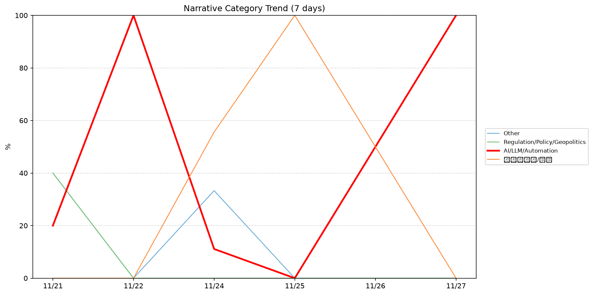
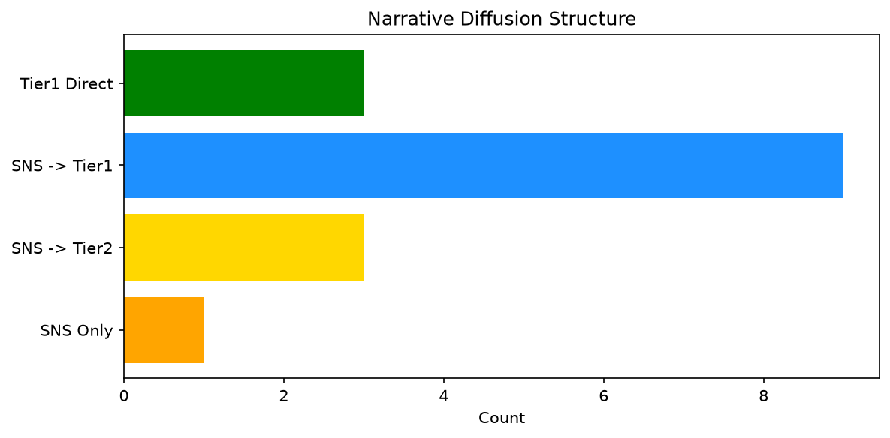

# 週次メタ分析レポート - 2026-11-28

> 分析期間: 過去7日間

---

## ショックタイプ分布

| ショックタイプ | 件数 |
|----------------|------|
| ナラティブシフト | 8 |
| 業績シグナル | 6 |
| テクノロジーショック | 3 |
| 規制ショック | 2 |
| ビジネスモデルショック | 1 |

---

## ナラティブ推移

### 2026-11-21
- その他: 40%
- 規制/政策/地政学: 40%
- AI/LLM/自動化: 20%

### 2026-11-22
- AI/LLM/自動化: 100%

### 2026-11-24
- ガバナンス/経営: 56%
- その他: 33%
- AI/LLM/自動化: 11%

### 2026-11-25
- ガバナンス/経営: 100%

### 2026-11-26
- AI/LLM/自動化: 50%
- ガバナンス/経営: 50%

### 2026-11-27
- AI/LLM/自動化: 100%

---

## ナラティブ伝播構造

| 伝播パターン | 件数 |
|--------------|------|
| SNS→Tier2 | 3 |
| SNS→Tier1 | 9 |
| Tier1直接 | 3 |
| カバレッジなし | 4 |
| SNSのみ | 1 |

---

## 過熱警告事後検証

> ※ "過熱警告を出したか"と"AI偏重が実際に続いたか"の検証

| 指標 | 値 |
|------|-----|
| 検証対象数 | 8 |
| 正警告（TP） | 0 |
| 過剰警告（FP） | 0 |
| 正常判定（TN） | 6 |
| 見逃し（FN） | 2 |
| Recall | 0.0% |

- **2026-11-21**: 正常判定 — No overheat and conditions normal: ai_continued=False, price_sustained=True.
- **2026-11-22**: 正常判定 — No overheat and conditions normal: ai_continued=False, price_sustained=True.
- **2026-11-23**: 正常判定 — No overheat and conditions normal: ai_continued=False, price_sustained=False.
- **2026-11-24**: 正常判定 — No overheat and conditions normal: ai_continued=False, price_sustained=False.
- **2026-11-25**: 見逃し — Missed overheat: AI events continued without price backing. An alert should have been raised.
- **2026-11-26**: 見逃し — Missed overheat: AI events continued without price backing. An alert should have been raised.
- **2026-11-27**: 正常判定 — No overheat and conditions normal: ai_continued=False, price_sustained=False.
- **2026-11-28**: 正常判定 — No overheat and conditions normal: ai_continued=False, price_sustained=False.

---

## 非AIハイライト（週次）

### 1. NVDA
- **サマリー**: 54件の言及（通常の2.8倍）
- **スコア**: 0.72
- **ナラティブ分類**: ガバナンス/経営
- **ショックタイプ**: ナラティブシフト
- **AI関連度**: 6%

### 2. NVDA
- **サマリー**: 前日比+31.48%の価格変動
- **スコア**: 0.61
- **ナラティブ分類**: ガバナンス/経営
- **ショックタイプ**: ナラティブシフト
- **AI関連度**: 6%

### 3. NVDA
- **サマリー**: 74件の言及（通常の3.7倍）
- **スコア**: 0.58
- **ナラティブ分類**: ガバナンス/経営
- **ショックタイプ**: ナラティブシフト
- **AI関連度**: 6%

### 4. CRWD
- **サマリー**: 出来高が平均の4.47倍
- **スコア**: 0.57
- **ナラティブ分類**: ガバナンス/経営
- **ショックタイプ**: 業績シグナル
- **AI関連度**: 8%

### 5. NVDA
- **サマリー**: 前日比-14.01%の価格変動
- **スコア**: 0.56
- **ナラティブ分類**: 規制/政策/地政学
- **ショックタイプ**: 規制ショック
- **AI関連度**: 7%

---

## 構造持続確率 Top3

| 順位 | 銘柄 | SPP | ショックタイプ | 伝播パターン | サマリー |
|------|------|-----|----------------|--------------|----------|
| 1 | NVDA | 0.66 | ビジネスモデルショック | SNS→Tier1 | 36件の言及（通常の1.7倍） |
| 2 | PATH | 0.63 | 業績シグナル | なし | 前日比+8.03%の価格変動 |
| 3 | CRWD | 0.58 | 業績シグナル | Tier1直接 | 5件の言及（通常の12.5倍） |

---

## イベント持続性

| 銘柄 | 出現日数/観測日数 | SPP推移 | 最新SPP |
|------|------------------|---------|---------|
| GOOGL | 5/6日 | 横ばい | 0.54 |
| NVDA | 4/6日 | 下降 | 0.66 |
| CRWD | 2/6日 | 下降 | 0.58 |
| PATH | 1/6日 | 横ばい | 0.63 |
| MSFT | 1/6日 | 横ばい | 0.53 |
| PLTR | 1/6日 | 横ばい | 0.46 |
| MDB | 1/6日 | 横ばい | 0.45 |
| JPM | 1/6日 | 横ばい | 0.42 |

---

## 転換点候補

- 「ガバナンス/経営」が2026-11-22→2026-11-24で56ポイント上昇（0% → 56%）
- 「AI/LLM/自動化」が2026-11-22→2026-11-24で89ポイント下降（100% → 11%）

---

## 組織インパクト仮説

### 1. 「ガバナンス/経営」ナラティブの急上昇は、この分野への注目シフトを示唆。関連するリスク管理体制の見直しが必要かもしれません。
- **根拠**: 「ガバナンス/経営」が2026-11-22→2026-11-24で56ポイント上昇（0% → 56%）

### 2. 「AI/LLM/自動化」ナラティブの下降は、市場の関心が他分野に移行中であることを示唆。この分野の見落としリスクに注意が必要です。
- **根拠**: 「AI/LLM/自動化」が2026-11-22→2026-11-24で89ポイント下降（100% → 11%）

### 3. GOOGL（AI/LLM/自動化）: 価格変動・言及急増 + ナラティブシフト + 5日間持続 + 引き締め環境 → 構造的な市場関心の変化の可能性
- **根拠**: 出現: 5/6日, SPP推移: 横ばい
- **根拠要素**:
- 価格変動
- 言及急増
- ナラティブシフト型
- テクノロジーショック型
- 5日間持続観測
- SPP横ばい（0.54）
- 引き締めレジーム下
- 関連: Now Google’s Familiar Faces AI feature works on Walmart’s $35 smart home camera too
- 関連: Google’s patent for custom AI video feeds paints a bleak picture of entertainment’s future
- **データ期間**: 2026-11-21〜2026-11-27 (6日間)
- **信頼度注記**: 観測データに基づく示唆であり、因果関係を示すものではありません

### 4. NVDA（規制/政策/地政学）: 出来高急増・価格変動 + ナラティブシフト + 4日間持続 + 引き締め環境 → 構造的な市場関心の変化の可能性、SPP下降中
- **根拠**: 出現: 4/6日, SPP推移: 下降
- **根拠要素**:
- 出来高急増
- 価格変動
- 言及急増
- ナラティブシフト型
- 規制ショック型
- ビジネスモデルショック型
- 4日間持続観測
- SPP下降（0.94→0.66）
- 引き締めレジーム下
- 関連: These stocks soared the most during a wild week highlighted by Huang’s return to Nvidia
- 関連: Nvidia hits pause on chip shipments to Southeast Asia
- **データ期間**: 2026-11-21〜2026-11-27 (6日間)
- **信頼度注記**: 観測データに基づく示唆であり、因果関係を示すものではありません

---

## 市場レジーム推移

| 日付 | レジーム | ボラティリティ | 下落比率 | 信頼度 |
|------|----------|---------------|----------|--------|
| 2026-11-28 | 引き締め | 59.8% | 93% | 100% |
| 2026-11-27 | 引き締め | 60.4% | 93% | 100% |
| 2026-11-26 | 引き締め | 59.2% | 93% | 100% |
| 2026-11-25 | 引き締め | 59.1% | 93% | 100% |
| 2026-11-24 | 引き締め | 60.2% | 93% | 100% |
| 2026-11-23 | 引き締め | 52.9% | 93% | 100% |
| 2026-11-22 | 引き締め | 53.0% | 93% | 100% |
| 2026-11-21 | 引き締め | 53.2% | 93% | 100% |

---

## 前週比較

> 比較期間: 2026-11-14〜2026-11-21 (7日分)

**イベント件数**: 今週 20 件 / 前週 29 件（差分 -9）

**支配的レジーム**: 引き締め（変化なし）

### ショックタイプ増減

| ショックタイプ | 今週 | 前週 | 差分 |
|----------------|------|------|------|
| テクノロジーショック | 3 | 6 | -3 |
| ナラティブシフト | 8 | 11 | -3 |
| ビジネスモデルショック | 1 | 0 | +1 |
| 業績シグナル | 6 | 9 | -3 |
| 規制ショック | 2 | 3 | -1 |

### ナラティブ比率変化

| カテゴリ | 今週平均 | 前週平均 | 差分(pt) |
|----------|----------|----------|----------|
| AI/LLM/自動化 | 47% | 16% | +31 |
| その他 | 12% | 47% | -35 |
| ガバナンス/経営 | 34% | 31% | +4 |
| 規制/政策/地政学 | 7% | 6% | +1 |

---

## レジーム・ナラティブ同時変動

> ※ 同時期の観測であり、因果関係を示すものではありません

- **2026-11-22**: レジーム異常（引き締め）と「AI/LLM/自動化」ナラティブ集中（100%）が共起
- **2026-11-25**: レジーム異常（引き締め）と「ガバナンス/経営」ナラティブ集中（100%）が共起
- **2026-11-27**: レジーム異常（引き締め）と「AI/LLM/自動化」ナラティブ集中（100%）が共起

---

## 来週の監視比重提案

### 1. 「金融/金利/流動性」の監視比重を維持・注視
- **根拠**: 週平均ナラティブ比率0%と低く、イベント未検出だが、構造的に重要なカテゴリのため意図的な監視継続を推奨。
- **週平均ナラティブ比率**: 0%

### 2. 「エネルギー/資源」の監視比重を維持・注視
- **根拠**: 週平均ナラティブ比率0%と低く、イベント未検出だが、構造的に重要なカテゴリのため意図的な監視継続を推奨。
- **週平均ナラティブ比率**: 0%

### 3. 「AI/LLM/自動化」の過集中に注意
- **根拠**: 週平均ナラティブ比率47%と高く、他カテゴリの構造変化を見落とすリスクがあります。
- **週平均ナラティブ比率**: 47%
- **⚡ 急変フラグ**: 直近100%へ急変 — 動向注視を推奨

### 4. 「ガバナンス/経営」の過集中に注意
- **根拠**: 週平均ナラティブ比率34%と高く、他カテゴリの構造変化を見落とすリスクがあります。
- **週平均ナラティブ比率**: 34%
- **⚡ 急変フラグ**: 直近0%へ急変 — 動向注視を推奨

---

*レポート生成日時: 2026-11-28 06:25:30*
